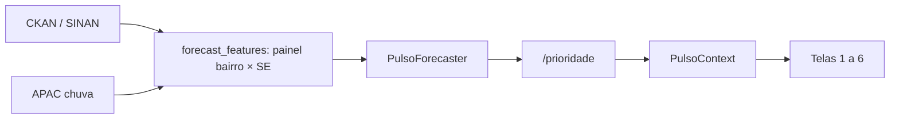

<!--
Título: curto, no padrão dos commits (`feat(painel): ...`, `fix(shared): ...`, `chore: ...`).
Descreva o efeito da mudança, não o processo. Não use travessão.

Regras do corpo:
- Bullets curtos. Nada de redação longa nem "rodei os testes" (o CI `ml.yml` já mostra).
- Prefira diagramas mermaid e trechos de código a parágrafos.
- Descreva só o resultado final do squash; histórico de commits intermediários não importa.
- Apague as seções que não se aplicam.
-->

## Resumo

-
-

## Fluxo

<!-- Opcional. Use quando a mudança mexer em como dados/sinais atravessam o sistema. -->



## Código

<!-- Trecho do ponto central da mudança ou exemplo de uso. Referencie `arquivo:linha`. -->

```python

```

## API

<!-- Só se algum endpoint (`/health`, `/bairros`, `/prioridade`, `/prioridade/<bairro_id>`, `/prioridade/explicacao`, `/mapa`) mudou de contrato. -->

```http
POST /prioridade
```

```json
{}
```

## Modelo (ML)

<!--
Só se houve retreino ou mudança em features/hiperparâmetros/dados de treino.
Antes = `forecast_meta.json` da `main`; depois = o do PR. O gate exige bater a persistência em MAE e P@10 em todos os horizontes.
-->

- `run_id`: `antes` → `depois`
- Features adicionadas/removidas:

| Horizonte | MAE antes | MAE depois | MAE persistência | P@10 antes | P@10 depois | P@10 persistência |
|---|---|---|---|---|---|---|
| h1 | | | | | | |
| h2 | | | | | | |
| h3 | | | | | | |
| h4 | | | | | | |

## Dados

<!-- Só se mudou fonte, coleta, cache (`backend/app/data/cache/`) ou cobertura de semanas. -->

- Fonte:
- Período / semanas epidemiológicas cobertas:
- Impacto na última semana servida:

## Interface

<!-- Obrigatório para mudanças visuais diretas ou indiretas. Anexe as imagens com `gh pr create --attach` ou arraste no GitHub. -->

| Tela | Antes | Depois |
|---|---|---|
| |  |  |

## Riscos

<!-- Opcional. Algo que o revisor precisa saber: dependência nova, migração de cache, retreino manual pendente. -->

-
