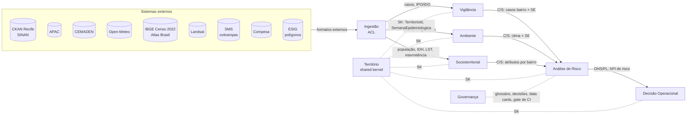

# Context map — PULSO

Mapa dos contextos delimitados (*bounded contexts*) do PULSO, de quem é cada um
e como eles se integram. Os nomes são os mesmos dos rótulos de contexto no Linear.
Os termos estão no [glossário](glossario.md).

## Visão geral

Legenda: **ACL** = camada anticorrupção · **SK** = shared kernel ·
**C/S** = cliente/fornecedor (o downstream pede, o upstream entrega um contrato) ·
**OHS/PL** = serviço aberto com linguagem publicada.

## Contextos

| Contexto | Tipo | Squad dono | Responsabilidade | Termos próprios | Código hoje | Histórias |
|---|---|---|---|---|---|---|
| **Território** | Shared kernel | Dados | Identidade territorial e calendário: bairro → DS → RPA → setor; SE | bairro, DS, RPA, setor censitário, SE | `backend/app/shared/territorio.py`, `semana_epidemiologica.py`; `distritos_sanitarios_*.csv`, `bairros_esig.geojson` | US02 |
| **Ingestão** | Genérico (ACL) | Dados (pedidos: Produto) | Buscar e traduzir fontes externas para o modelo interno; preservar proveniência (URL, hash, data de coleta) | fonte, snapshot, coleta | `backend/app/services/ckan_client.py`, `apac_client.py`, `data_sync.py` (coleta) | US03, US06 |
| **Vigilância** | Suporte | Dados | Sinais epidemiológicos e vetoriais por bairro × SE | caso provável, data de notificação, atraso, IPO/IDO, ciclo, ano epidêmico | `backend/scripts/build_sinan_historico.py`, `data_sync.normalize_sinan` | US04, US12 |
| **Ambiente** | Suporte | Dados | Clima por SE: chuva (APAC, CEMADEN) e temperatura do ar | chuva semanal, estação, temperatura média/máxima | `data_sync.py` (agregação APAC/Open-Meteo), `apac_clima_semana_*.csv` | US05, US07, US10 |
| **Socioterritorial** | Suporte | Dados | Atributos estáveis do território | população, densidade, IDH, ilha de calor, intermitência, ZEIS, vulnerabilidade | `bairros_lookup.json`, `backend/scripts/build_bairros_lookup.py` | US08, US09, US11, US13 |
| **Análise de Risco** | **Núcleo** | Inteligência (painel: Dados) | Painel, incidência, canal endêmico, modelos, hotspots, perfis, explicação, validação | incidência, canal endêmico, nível de risco, horizonte, hotspot, perfil territorial, painel, score | `backend/app/shared/painel_schema.py`, `backend/scripts/gerar_painel.py`, `forecast_features.py`, `forecaster.py`, `forecast_serving.py`, `model.py`, `train_forecast.py` | US14, US16–US27, SP-1–SP-5 |
| **Decisão Operacional** | **Núcleo** | Produto | Responder “onde agir primeiro”: fila, capacidade, recomendação, decisão registrada | fila de prioridades, capacidade, cobertura operacional, recomendação, decisão registrada | `backend/app/main.py` (API), `src/` (telas, `PulsoContext`) | US28–US33, US36, US38, UX01–UX07 |
| **Governança** | Genérico | Produto + Inteligência | Linguagem comum, decisões, qualidade e documentação de dados/modelo, gate de CI | decisão (ADR), data card, model card, gate | `docs/`, `.github/workflows/`, `export_model.py` (gate), data cards | US01, US15, US34, US35, US37 |

## Relações

| Upstream → Downstream | Padrão | Contrato / linguagem publicada | Regras |
|---|---|---|---|
| Sistemas externos → Ingestão | ACL | Formato de cada fonte (CSV CKAN, HTML APAC, planilhas SMS/Compesa) | Nenhum nome ou código de fonte externa (`DT_NOTIFIC`, `ds_semana_notificacao`, códigos de estação) passa da Ingestão. Variações de schema entre anos (ex.: SINAN 2016–2020 × 2021+) são resolvidas ali. Falha não vira zero. |
| Território → todos | Shared kernel | `TerritorioId`, `SemanaEpidemiologica`, `normalizar_nome_bairro` | Muda só com acordo dos 3 squads. Não depende de `app.services`. Bairro sem DS é erro (`BairroDesconhecidoError`), nunca DS ambíguo. |
| Ingestão → Vigilância / Ambiente / Socioterritorial | Cliente/fornecedor | Registros normalizados com proveniência | Ausente ≠ zero; cobertura sempre informada. |
| Vigilância → Análise de Risco | Cliente/fornecedor | Casos prováveis por `bairro × SE` (SE de início de sintomas, [decisão 0001](decisoes/0001-semana-epidemiologica.md)) + flag de SE em consolidação | Análise de Risco não refaz filtros de caso. |
| Ambiente → Análise de Risco | Cliente/fornecedor | Chuva e temperatura por SE (hoje municipal; por DS na US05) | Semana incompleta é marcada, não preenchida em silêncio. |
| Socioterritorial → Análise de Risco | Cliente/fornecedor | Atributos por bairro (e DS por agregação) | Soma de população confere com o total municipal (US08). |
| Análise de Risco → Decisão Operacional | OHS / linguagem publicada | `POST /prioridade`, `GET /mapa`, `POST /prioridade/explicacao`; futuro `GET /risco/distritos?semana_id=&horizonte=` (US28) | A API expõe termos do glossário (nível de risco, incidência, horizonte, cobertura de dados). Mudança de contrato exige teste de contrato (US28). |
| Governança ↔ todos | Transversal | Glossário, decisões (`docs/decisoes/`), data cards, gate de métricas e schema na CI | Termo novo entra no glossário no mesmo PR. Modelo só é promovido se passar no gate (US26/US34). |

## Divergências conhecidas entre código e mapa

Ficam registradas aqui até serem corrigidas pelas histórias citadas.

- `data_sync.py` mistura **Ingestão**, **Vigilância** e **Ambiente**: coleta,
  filtra casos e agrega chuva no mesmo módulo.
- A SE dos casos vem de `DT_NOTIFIC` em `data_sync.py` e de `ds_semana_notificacao`/`SEM_NOT`
  no histórico 2016–2025. O alvo é a data de início de sintomas ([decisão 0001](decisoes/0001-semana-epidemiologica.md)).
- `data_sync.normalize_sinan` filtra por município de **notificação** (`ID_MUNICIP`),
  enquanto o histórico (US04) usa município de **residência**. O termo **caso
  provável** exige residência.
- A normalização de nome de bairro existe em três cópias (`territorio.py`,
  `data_sync.norm`, `forecast_features._norm`). O shared kernel deve ser a única fonte.
- A API e as telas usam “classificação” (corte do score) onde o produto fala em
  “risco”. **Nível de risco** fica reservado ao canal endêmico (US22); ver o
  [glossário](glossario.md#nível-de-risco).

## Responsáveis e revisão

Squad Dados: Beatriz Loyola · Squad Inteligência: Pedro Bedor · Squad Produto:
João Euclides · Orientador: Diego. Mesma regra do [glossário](glossario.md#responsáveis-e-revisão):
o merge do PR na `main` vale como revisão de todos.
